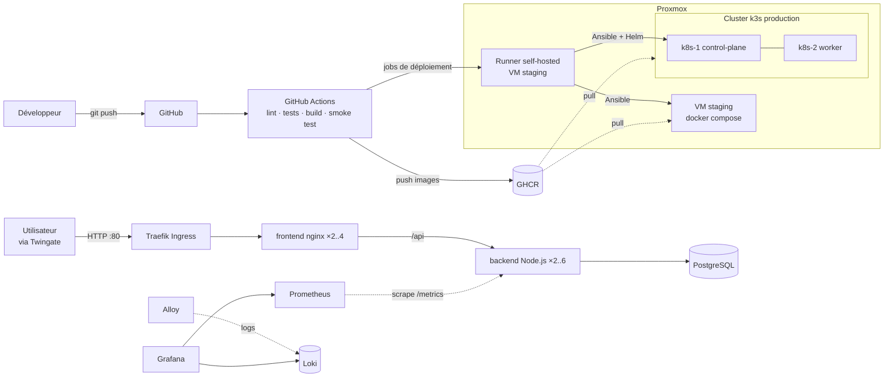
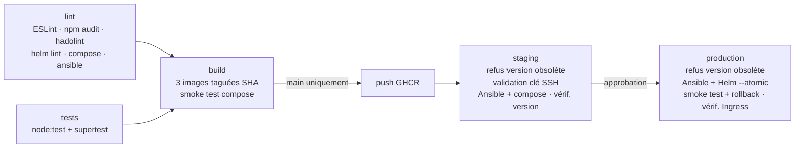

# TaskFlow : déploiement continu d'une application multi-composants

Projet DevOps / SysOps ESGI M1 (cours DevOps de Tom AVENEL). Une application web de gestion de tâches (frontend, backend, base de données) livrée en continu sur une infrastructure Proxmox, entièrement décrite en code.

Documentation :
- [Tutoriel de mise en place](docs/TUTORIEL.md)
- [Scénario de soutenance](docs/DEMO.md)
- [Contrat d'intégration inter-équipes](docs/CONTRAT-INTEGRATION.md)
- [Journal des modifications](#journal-des-modifications)

| Exigence du sujet | Mise en œuvre |
|---|---|
| Conteneurs | 1 Dockerfile par composant, images non-root, publiées sur GHCR en **privé** (lecture par jeton) |
| Staging | Docker Compose sur une VM dédiée |
| Production | Kubernetes k3s sur 2 VM, application packagée en chart Helm |
| IaC | Ansible : de la VM vierge au cluster supervisé + application déployée |
| CI/CD | GitHub Actions : lint, tests, build, smoke test, push, staging, production |
| Zero-downtime | Rolling update (maxUnavailable 0), probes, arrêt gracieux, PDB, rollback automatique |
| Auto-scaling | HorizontalPodAutoscaler sur le CPU (2 à 6 pods backend) |
| Observabilité | Prometheus, Grafana (dashboard des 4 golden signals), cAdvisor, Alertmanager |
| Logs centralisés | Loki + Grafana Alloy, recherche par service, date et gravité |
| Revue de code | `main` protégée : PR obligatoire, approbation par un autre membre, CI verte |
| Secrets | Hors du dépôt : `secrets.yml` sur staging-1 (non versionné), secrets GitHub Actions, secrets Kubernetes ; images lues avec un jeton en lecture seule |

## Architecture



| Composant | Techno | Port | Rôle |
|---|---|---|---|
| frontend | nginx (non-root) | 8080 | Sert l'interface et fait reverse proxy de `/api` vers le backend |
| backend | Node.js 24 / Express | 3000 | API REST `/api/tasks`, migrations de schéma, métriques Prometheus |
| db | PostgreSQL 17 | 5432 | Persistance (StatefulSet + volume en production) |

## Arborescence (mono-repo)

```
app/
  backend/            API Node.js + tests + Dockerfile
  frontend/           interface statique + template nginx + Dockerfile
  db/                 image PostgreSQL (version propre dans VERSION)
deploy/
  compose/            staging : compose.yaml (+ compose.build.yaml pour le dev local, profil monitoring)
  helm/taskflow/      production : chart Helm (Deployments, HPA, PDB, StatefulSet, Ingress, ServiceMonitor, dashboard)
  k8s/                générateur de charge pour la démo d'auto-scaling
infra/ansible/
  playbooks/          site (tout), bootstrap (python3/sudo), deploy-staging, deploy-prod, github-runner
  roles/              common, docker, k3s_server, k3s_agent, helm, monitoring, app_staging, app_prod, github_runner
  inventories/        hosts.yml (3 VM) + group_vars (versions figées, registry, NodePorts…)
.github/
  workflows/          pipeline CI/CD
  actionlint.yaml     configuration du lint des workflows (label du runner)
scripts/              sonde de disponibilité (démo zero-downtime), installation d'Ansible
docs/                 tutoriel de mise en place, scénario de démo, contrat d'intégration
```

## Démarrage local (Docker Desktop)

```bash
cd deploy/compose
cp .env.example .env          # IMAGE_OWNER=local, DB_PASSWORD=...
docker compose -f compose.yaml -f compose.build.yaml up -d --build
# Application : http://localhost:8080
# + monitoring : ajouter --profile monitoring (Grafana http://localhost:3000, admin/admin)
```

Tests et lint du backend : `cd app/backend && npm ci && npm test && npm run lint`.

## Mise en place de l'infrastructure

**Le pas-à-pas complet est dans [docs/TUTORIEL.md](docs/TUTORIEL.md)** : VM Proxmox, Twingate, organisation GitHub, Ansible, runner, premier déploiement et dépannage.

| VM Proxmox (KVM, Debian 13) | IP | Rôle | Ressources |
|---|---|---|---|
| staging-1 | 10.1.20.72 | Docker Compose, runner GitHub Actions, poste d'administration Ansible | 4 vCPU, 4 Go, 30 Go |
| k8s-1 | 10.1.20.73 | k3s control-plane + monitoring | 4 vCPU, 6 Go, 30 Go |
| k8s-2 | 10.1.20.74 | k3s worker | 2 vCPU, 4 Go, 30 Go |

En résumé :
1. Renseigner les IP et l'utilisateur SSH dans [hosts.yml](infra/ansible/inventories/proxmox/hosts.yml), puis `image_owner` et `github_repository` dans [group_vars/all.yml](infra/ansible/inventories/proxmox/group_vars/all.yml).
2. Pousser sur un dépôt **public** de l'organisation GitHub. Les images restent **privées** sur GHCR : créer un jeton GitHub *classic* `read:packages`, que les serveurs utilisent pour les télécharger.
3. Depuis `staging-1`, lancer `ansible-playbook playbooks/site.yml -e @secrets.yml -K`. `-K` ne sert qu'au premier lancement. Ce playbook idempotent construit toute l'infrastructure et déploie l'application, en ~10 min mesurées.
4. Dans GitHub, créer les secrets, les variables et l'environnement `production` avec approbation. Installer ensuite le runner avec `playbooks/github-runner.yml`. Le runner se connecte à GitHub en sortie : aucun port n'est à ouvrir sur le réseau Proxmox.

Accès, via Twingate :

| Service | URL |
|---|---|
| Application de production | http://10.1.20.73/ |
| Grafana de production (dashboards, logs Loki) | http://10.1.20.73:30300 |
| Prometheus de production | http://10.1.20.73:30090 |
| Application de staging | http://10.1.20.72:8080 |
| Grafana de staging | http://10.1.20.72:3000 |

## Pipeline CI/CD



- **Branche `main` protégée** (ruleset `protection-main`) : toute modification passe par une pull request **approuvée par un autre membre**, avec les 3 checks verts (lint, tests, build). Une nouvelle approbation est exigée après tout nouveau push. Force push et suppression de `main` sont interdits.
- **Images privées** : la CI publie sur GHCR avec son `GITHUB_TOKEN`. Les serveurs les téléchargent avec un jeton classique en lecture seule (`read:packages`), via `docker login` sur le staging et un secret `docker-registry` créé par la chart en production.
- **Pull request** : lint, tests, build et smoke test. Rien n'est publié ni déployé.
- **Merge sur `main`** : le pipeline complet. Chaque image porte le SHA du commit : une version est identifiable de bout en bout (pipeline, registry, pied de page de l'interface, logs).
- **Exécution** : les jobs de déploiement tournent sur le runner self-hosted et appellent les **mêmes playbooks Ansible** que ceux utilisés à la main. Il n'y a pas de logique de déploiement cachée dans la CI.
- **Garde-fous des jobs de déploiement** :
  - refus si le commit n'est plus le dernier de `main` : une relance d'un ancien run ne peut pas ramener la production en arrière ;
  - nettoyage et validation de la clé SSH du secret, avec affichage de son empreinte ;
  - en production, smoke test frontend → backend → BDD après Helm, avec `helm rollback` automatique en cas d'échec.

## Zero-downtime et auto-scaling

| Mécanisme | Où |
|---|---|
| Rolling update `maxSurge: 1`, `maxUnavailable: 0` | [values.yaml](deploy/helm/taskflow/values.yaml) |
| Readiness `/ready` (BDD joignable, pas en arrêt) ≠ liveness `/health` | [app.js](app/backend/src/app.js), [backend.yaml](deploy/helm/taskflow/templates/backend.yaml) |
| `preStop` + arrêt gracieux sur SIGTERM (fin des requêtes en cours) | [server.js](app/backend/src/server.js) |
| Replicas répartis sur les 2 nœuds + PodDisruptionBudget : un nœud peut être drainé sans coupure | templates backend et frontend |
| `helm --atomic` : retour automatique à la version précédente si les pods ne deviennent pas prêts (délai `helm_wait_timeout`, 5 min par défaut) | [app_prod](infra/ansible/roles/app_prod/tasks/main.yml) |
| Smoke test post-déploiement frontend → backend → BDD, avec `helm rollback` si échec | [app_prod](infra/ansible/roles/app_prod/tasks/main.yml) |
| Refus de déployer un commit qui n'est plus le dernier de `main` | [ci-cd.yml](.github/workflows/ci-cd.yml) |
| Migrations rétrocompatibles (ancienne et nouvelle version tournent ensemble pendant le rolling update) | [db.js](app/backend/src/db.js) |
| HPA CPU 60 % : backend 2→6 pods, frontend 2→4 pods ; metrics-server inclus dans k3s | templates backend et frontend |
| La BDD a son propre cycle de version : un déploiement applicatif ne redémarre pas PostgreSQL | `db.imageTag`, [app/db/VERSION](app/db/VERSION) |

**Mesuré en production réelle** : 0 erreur sur 285 puis 349 requêtes pendant deux rolling updates déclenchés par la CI.

Limite assumée, conformément au sujet (pas de haute disponibilité demandée) : PostgreSQL est une instance unique. Sa mise à jour provoque une courte indisponibilité.

## Observabilité

- **Métriques applicatives** (`/metrics`, prom-client) :
  - `http_requests_total` et `http_request_duration_seconds` (trafic, erreurs, latence) ;
  - `taskflow_db_up` ;
  - `taskflow_tasks_created_total` (métrique métier) ;
  - métriques process et event loop Node.js (saturation).
- **Métriques d'infrastructure** : cAdvisor via le kubelet (CPU et mémoire par conteneur), node-exporter, kube-state-metrics (replicas, redémarrages).
- **Dashboard** *TaskFlow - Golden signals*, livré avec la chart et chargé automatiquement par Grafana ; c'est le même fichier en staging.
- **Logs** : JSON sur stdout (backend pino, frontend nginx) avec un champ `level`. Exemple de requête dans Grafana > Explore > Loki : `{namespace="taskflow", component="backend", level="error"}`.
- **Alertes** : règles par défaut de kube-prometheus-stack (pod en crash loop, nœud indisponible…), visibles sur http://10.1.20.73:30090/alerts.

## Exploitation au quotidien

| Besoin | Comment |
|---|---|
| Livrer une modification | Branche, PR, relecture par un autre membre, merge. Le pipeline déploie le staging, puis la production après approbation (*Review deployments*). Détail : [tutoriel, étape 7](docs/TUTORIEL.md) |
| Déploiement en échec | Corriger, puis relancer le run du **dernier** commit de `main`. Les relances d'anciens runs sont refusées |
| Revenir en arrière | Recommandé : `git revert` + PR. En urgence, sur k8s-1 : `KUBECONFIG=/etc/rancher/k3s/k3s.yaml helm rollback taskflow -n taskflow` |
| Lancer un playbook à la main | `ssh admin@10.1.20.72`, `cd ~/taskflow && git pull`, `cd infra/ansible`, `ansible-playbook playbooks/<playbook>.yml -e @secrets.yml`. Sans `-e image_tag=<sha>`, la version déjà déployée est conservée |
| Commandes Kubernetes | `ssh admin@10.1.20.73` puis `kubectl …` (ou `kubeconfig-prod.yaml` depuis un PC, voir le tutoriel) |
| Logs d'un service | Grafana > Explore > Loki : `{namespace="taskflow", component="backend"}` ; en direct : `kubectl -n taskflow logs -f deploy/taskflow-backend` |
| Logs du runner CI | Sur staging-1 : `sudo journalctl -u 'actions.runner.*' -f` |
| Sonde de disponibilité | `.\scripts\check-availability.ps1 -Url http://10.1.20.73` (Windows) ou `scripts/check-availability.sh` |

| Secret | Où il vit |
|---|---|
| `db_password`, `k3s_token`, `grafana_admin_password`, `registry_password` | `~/taskflow/infra/ansible/secrets.yml` sur staging-1 (mode 600, ignoré par git) |
| `ANSIBLE_SSH_PRIVATE_KEY`, `DB_PASSWORD`, `GRAFANA_ADMIN_PASSWORD`, `GHCR_READ_TOKEN` | Secrets GitHub Actions du dépôt |
| Clé SSH Ansible | `~/.ssh/ansible` sur staging-1, autorisée pour `admin` sur les 3 VM |
| Mot de passe BDD et jeton de lecture des images en production | Secrets Kubernetes `taskflow-db` et `taskflow-registry` (namespace `taskflow`) |
| Mêmes valeurs en staging | `/opt/taskflow/deploy/compose/.env` (mode 600) |

## Versions déployées

Relevées sur les VM le 23/11/2026. Celles marquées 📌 sont figées dans [group_vars/all.yml](infra/ansible/inventories/proxmox/group_vars/all.yml).

| Composant | Version |
|---|---|
| Debian (VM) | 13.8, noyau 6.12 |
| k3s (Kubernetes) | 📌 v1.37.2+k3s1, avec Traefik v3.7 |
| Helm | v3.22.1 |
| kube-prometheus-stack | 📌 chart 93.9.0 : Prometheus v3.16, Grafana 13.3.1, Alertmanager v0.35 |
| Loki / Grafana Alloy | 📌 charts 7.7.0 / 1.16.0 : Loki 3.6, Alloy v1.22 |
| Docker (staging) | 29.10.0, Compose 5.8.0 |
| Ansible | ansible-core 2.22.0 |
| Runner GitHub Actions | 2.338.2 |
| Application | Node.js 24, nginx 1.28 (non-root), PostgreSQL 17 |

## Ce qui a été validé

### En local (Docker Desktop, cluster k3s v1.31 jetable, conteneurs Debian 13)

| Test | Résultat |
|---|---|
| Tests unitaires et d'API | 16/16 réussis, ESLint propre |
| Hadolint (3 Dockerfiles), `helm lint`, `ansible-playbook --syntax-check`, config Alloy | OK |
| Stack docker compose : création, mise à jour et lecture de tâches via le frontend, métriques, logs JSON | OK |
| Grafana (compose) : dashboard provisionné (13 panneaux), cibles Prometheus `up` | OK |
| Arrêt gracieux du backend (SIGTERM) | sortie propre (code 0) après 5 s |
| Recréation du backend seul en compose (nouvelle IP) | 40/40 requêtes OK |
| Rolling update v1 → v2 sous trafic continu | 898 requêtes, **0 erreur**, données conservées |
| Rolling update v3 → v4 (frontend + backend) sous trafic | 523 requêtes, **0 erreur** |
| Auto-scaling sous charge | 2 → 6 pods backend en ~45 s, retour à 2 après la charge |
| Déploiement d'une image inexistante | rollback automatique, 473 requêtes, **0 erreur** |
| Ansible sur un Debian 13.7 nu (root, sans Python ni sudo) : `bootstrap.yml`, rôles `common` et `docker` (dépôt Docker trixie) | OK jusqu'aux étapes qui demandent systemd, absent d'un conteneur |
| Compte sudoer `admin` sur Debian 13 : 1er passage avec mot de passe sudo (`-K`), puis 2e passage sans mot de passe, comme la CI | OK : règle `NOPASSWD` posée, élévation sans mot de passe ensuite |
| Chart Helm avec images privées : rendu avec et sans jeton, secret `docker-registry` décodé, `kubeconform` (schémas Kubernetes) | 3 pods avec `imagePullSecrets`, 14/14 ressources valides |
| Workflow GitHub Actions passé à `actionlint` (+ shellcheck) | 0 problème |
| Jeton de lecture GHCR (compte Poliaqt, droit `read:packages` seul) | 3 images privées lisibles avec le jeton (API registry et `docker login`), refusées sans jeton |

### Sur l'infrastructure Proxmox (23/11/2026)

| Test | Résultat |
|---|---|
| `site.yml` complet sur 3 VM Debian 13 vierges (KVM) | `failed=0` sur les 3 VM, en ~10 min |
| Cluster k3s v1.37.2 | `k8s-1` (control-plane) et `k8s-2` en Ready |
| Production | 2 backend + 2 frontend **répartis sur les 2 nœuds**, PostgreSQL, 2 HPA avec métriques CPU, Ingress Traefik sur les 2 nœuds |
| Images privées | Téléchargées via le secret `docker-registry` en production et `docker login` en staging |
| Application | Production http://10.1.20.73 et staging http://10.1.20.72:8080 répondent ; création d'une tâche en production OK |
| Monitoring | 10 pods de monitoring Running, Prometheus collecte les 2 backends, dashboard *TaskFlow - Golden signals* chargé, sources Prometheus / Loki / Alertmanager |
| Logs centralisés | Loki reçoit les logs, labels `component` (backend, frontend, db…) et `level` (info, warn, error…) |
| Staging | 6 conteneurs (application + Prometheus, Grafana, cAdvisor) démarrés et sains |
| Déploiement continu de bout en bout (run #7, puis run #9) | Build, images privées sur GHCR, runner self-hosted sur Proxmox, Ansible, staging, puis production après approbation |
| **Zero-downtime en production réelle**, rolling update déclenché par la CI et sondé toutes les 0,3 s | Run #7 : **285 requêtes, 0 erreur**. Run #11 : **349 requêtes, 0 erreur**, anciens et nouveaux pods en alternance pendant 12,6 s. PR #7 (`d9e9960`, 24/11) : **778 requêtes, 0 erreur**, 11,2 s de cohabitation |
| Garde-fou « déploiement obsolète » (run #11, commit `74d39e3`) | Étape passée ; staging puis production déployés en `74d39e3` |

## Difficultés rencontrées et solutions

| Problème constaté en test | Cause | Solution |
|---|---|---|
| Les pods backend restent en `CreateContainerConfigError` | `USER node` (nom) dans le Dockerfile : Kubernetes ne peut pas vérifier `runAsNonRoot` | UID numérique `USER 1000:1000`, règle B5 du contrat d'intégration |
| Erreurs 502 après la recréation du backend en docker compose | nginx résout le nom du backend une seule fois, au démarrage, et garde l'ancienne IP | `resolver` dynamique (DNS détecté par l'image nginx) et variable dans `proxy_pass` ; FQDN du Service en Kubernetes |
| Une mise à jour casse `/api` alors que Helm la déclare réussie | Le frontend est « prêt » (sa sonde ne teste pas le backend), donc `--atomic` ne voit rien | Smoke test post-déploiement frontend → backend → BDD dans Ansible, avec `helm rollback` automatique en cas d'échec |
| Arrêt gracieux interrompu (SIGKILL au bout de 3 s) en compose | Délai d'arrêt Docker trop court | `stop_grace_period: 20s` explicite |
| Premier `site.yml` en échec : `swapoff: Not superuser.` alors qu'on est root | Les « VM » Proxmox étaient des **conteneurs LXC** à 1 CPU / 512 Mo : pas assez de droits noyau ni de RAM pour k3s | Recréation en vraies VM KVM ; garde-fous Ansible en tête du rôle `common` (refus des conteneurs, RAM minimale) pour échouer tout de suite avec un message clair |
| Relancer `site.yml` à la main a remplacé la production (`37106af`) par une **vieille image `latest`** : le logo du frontend avait disparu en prod mais pas en staging | Sans version précisée, `site.yml` déployait `latest`. Kubernetes a réutilisé l'image `latest` restée en cache sur les nœuds (`IfNotPresent`), alors que le staging, lui, retélécharge toujours | Sans `-e image_tag`, les rôles `app_prod` et `app_staging` **conservent la version déjà déployée**. La chart retélécharge toujours une image `latest` (`Always`) |
| La relance d'un ancien run (#7) a redéployé une version **plus ancienne** que celle déjà en production (#9) | Une relance rejoue le commit d'origine, et l'approbation de la production ne vérifie pas que c'est le dernier | Garde-fou dans les jobs de déploiement : refus si le commit n'est pas le dernier de `main`. Retour arrière volontaire : `git revert` + PR, ou `helm rollback` |
| Déploiement CI en échec, Ansible `UNREACHABLE`, alors que la clé fonctionne en manuel | Secret `ANSIBLE_SSH_PRIVATE_KEY` abîmé au copier-coller : le job ne présentait aucune clé valide (vu dans le journal sshd) | Copie par `Set-Clipboard` ; le workflow nettoie et valide la clé avec `ssh-keygen` et affiche son empreinte |
| Premier job de déploiement en échec (`Collections Ansible`) juste après l'installation du runner | Le rôle `github_runner` démarrait le service **avant** d'installer Ansible : le runner a pris un job en attente dans la seconde | Installation d'Ansible déplacée avant l'enregistrement et le démarrage du runner |
| Pas de métriques par conteneur avec cAdvisor sous Docker Desktop | cAdvisor ne voit pas les conteneurs de Docker Desktop | En production, on utilise le cAdvisor intégré au kubelet (k3s) ; sur la VM staging, le daemon Docker accepte les anciens clients API |

## Documentation

- [docs/TUTORIEL.md](docs/TUTORIEL.md) : la mise en place pas à pas, des VM vierges au premier déploiement continu.
- [docs/CONTRAT-INTEGRATION.md](docs/CONTRAT-INTEGRATION.md) : la spécification commune proposée aux autres équipes, côté conteneurs (DevOps) et côté plateforme (SysOps).
- [docs/DEMO.md](docs/DEMO.md) : la fiche d'exécution de la soutenance. Pour chaque démo : le critère visé, le terminal à utiliser, les commandes exactes, le résultat attendu et la remise en état.

## Répartition des rôles

| Membre | Rôle | Périmètre principal |
|---|---|---|
| _à compléter_ | Dev / App | `app/`, tests, contrat d'intégration |
| _à compléter_ | Infra / SysOps | `infra/ansible/`, k3s, chart Helm, zero-downtime, HPA |
| _à compléter_ | CI/CD | `.github/workflows/`, registry, runner, environnements GitHub |
| _à compléter_ | Observabilité | monitoring, dashboard, Loki, alertes, dossier de projet |

## Journal des modifications

Le plus récent en haut. Chaque modification du projet est notée ici.

### 24/11/2026 : scénario de démo en fiche d'exécution
- `docs/DEMO.md` réécrit :
  - les 3 terminaux de la démo (LOCAL, ADMIN, CLUSTER) et la préparation avec vérifications ;
  - pour chaque démo : critère de la grille, commandes complètes, résultat attendu ;
  - un ordre conseillé (la PR de la démo 4 est lancée en premier, pour que la CI tourne pendant les autres démos) ;
  - une section de remise en état et un plan B.
- Démo de fonctionnalité : un compteur de tâches restantes, en deux modifications du frontend, au lieu de la priorité des tâches (plus rapide et sans migration en direct). Code vérifié : syntaxe et rendu.
- Ajouts : recréation du nœud k8s-2 avec `kubectl delete node` (sinon k3s refuse le retour du nœud), refus d'un vieux run en relançant un seul job, sonde lancée avec `-ExecutionPolicy Bypass`, retour à la normale de l'auto-scaling.
- Tutoriel : la case de préparation pointe vers la démo 4.

### 24/11/2026 : une relance de `site.yml` ne change plus la version servie
- Incident : le 23/11 à 22 h 26, une relance manuelle de `site.yml` (répétition de la démo) a remplacé la production `37106af` par une ancienne image `latest` restée en cache sur les nœuds. Le logo du frontend avait disparu en production, mais pas en staging (qui retélécharge toujours).
- `group_vars` : `image_tag` vide par défaut (au lieu de `latest`).
- Rôles `app_prod` et `app_staging` : sans version explicite, ils relisent la version déjà déployée (valeurs de la release Helm, `.env` du staging) et la conservent. `latest` n'est utilisé qu'au tout premier déploiement. La CI, qui passe toujours le SHA, n'est pas concernée.
- Chart : `imagePullPolicy: Always` quand le tag vaut `latest`, pour ne jamais réutiliser une vieille image en cache.
- Testé : 9 cas de choix de version avec ansible-core 2.22 (relance, premier déploiement, version explicite), rendu de la chart (`Always` pour `latest`, `IfNotPresent` pour un SHA), syntaxe des playbooks.
- Production restaurée par le pipeline de la PR #7 : `d9e9960` en staging et en production, logo revenu. Rolling update sondé : 778 requêtes, 0 erreur. Le staging, mis à jour par recréation des conteneurs docker compose, est indisponible quelques secondes pendant sa mise à jour : c'est attendu, le zero-downtime ne concerne que la production.

### 23/11/2026 : mise à jour de la documentation technique, versions figées
- Décision : le dépôt reste **public**. En privé, le plan gratuit de GitHub désactiverait la relecture obligatoire des PR et l'approbation de la production. Aucun secret n'est dans le dépôt, et les images restent privées.
- README :
  - nouvelles sections « Exploitation au quotidien » (livrer, revenir en arrière, logs, emplacement des secrets) et « Versions déployées » (relevées sur les VM) ;
  - garde-fous du pipeline et mesures de zero-downtime ;
  - ressources réelles des VM, arborescence complète ;
  - tableau des validations remis en ordre.
- Ansible : versions figées dans `group_vars` (k3s v1.37.2+k3s1, kube-prometheus-stack 93.9.0, Loki 7.7.0, Alloy 1.16.0), soit les versions validées sur Proxmox, pour une reconstruction reproductible. Délai d'attente Helm réglable (`helm_wait_timeout`, 5 min par défaut).
- Scénario de démo réécrit :
  - Twingate, et les 3 terminaux de la démo (admin, cluster, PowerShell local) ;
  - commandes exactes, dont le déploiement cassé avec un rollback en 90 s ;
  - section « Chiffres à citer ».
- Tutoriel : ressources réelles, durée mesurée, lancement détaché, consignes sur les runs en attente, l'approbation et le jeton à supprimer après la soutenance.

### 23/11/2026 : production à jour avec le garde-fou actif
- PR #5 mergée : le run #11 (`74d39e3`) déploie le staging puis la production après approbation. Les deux environnements sont à jour avec `main`.
- Deuxième mesure de zero-downtime en production : 349 requêtes pendant la bascule, 0 erreur, 12,6 s de cohabitation entre ancienne et nouvelle version.

### 23/11/2026 : premier déploiement continu complet, refus des versions obsolètes
- Secret `ANSIBLE_SSH_PRIVATE_KEY` recopié proprement : la relance du run #7 déploie le staging, puis la production après approbation.
- Zero-downtime mesuré en production réelle pendant le rolling update déclenché par la CI : 285 requêtes, 0 erreur.
- Incident : le run #9 (`f09c472`, PR #4) avait déjà déployé la production ; la relance approuvée du run #7 (`ff90456`) l'a ramenée à une version plus ancienne.
- Workflow : nouvelle étape « Refuser un déploiement obsolète » dans les jobs staging et production. Le déploiement est refusé si le commit du run n'est plus le dernier de `main`. Testé : ancien commit refusé, dernier commit accepté.
- Tutoriel : dépannage « déploiement obsolète refusé » et procédure de retour arrière.

### 23/11/2026 : runner GitHub en service
- Étape 6 : secrets, variables, environnement `production` configurés dans GitHub ; runner `staging-1` installé (service systemd, label `proxmox`) et connecté.
- Le premier job pris par le runner (run #3, ancien commit) a échoué à l'étape `Collections Ansible` : le rôle démarrait le runner avant d'installer Ansible. Rôle `github_runner` corrigé (Ansible installé avant l'enregistrement du runner).
- Garde-fous VM (PR #3) mergés dans `main`.
- Run #7 : build OK, mais le déploiement staging échoue avec Ansible `UNREACHABLE` (code 4). La clé est bonne sur staging-1, mais le job n'a présenté aucune clé valide : le secret `ANSIBLE_SSH_PRIVATE_KEY` est mal copié.
- Workflow : la clé est nettoyée (BOM UTF-8, CR, espaces, lignes vides) puis vérifiée avec `ssh-keygen` avant Ansible, avec un message d'erreur explicite et l'empreinte de la clé chargée. Testé sur 6 cas : clé intacte, BOM, CRLF + espaces, lignes vides, ligne END manquante, clé publique collée par erreur.
- Tutoriel : copie de la clé via `Set-Clipboard`, nouveau cas de dépannage.

### 23/11/2026 : fond de page du frontend (PR #2)
- Frontend : logo `claude-logo.svg` en arrière-plan fixe, centré et atténué par un voile translucide pour garder le contenu lisible (`style.css`). PR #2 de Zerda, mergée dans `main`.

### 23/11/2026 : premier lancement sur Proxmox, passage en VM
- Étape 4 réalisée sur staging-1 (Ansible, clé SSH copiée sur les 3 machines, `secrets.yml`). Premier `site.yml` en échec dès le rôle `common` : les machines étaient des conteneurs LXC (1 CPU, 512 Mo).
- Décision : recréer les 3 machines en VM KVM (staging 2 CPU/4 Go, k8s-1 4 CPU/6 Go, k8s-2 2 CPU/4 Go), conformément au sujet.
- Sur les VM KVM : étape 4 refaite, puis **`site.yml` réussi du premier coup** (`failed=0`, ~10 min). Résultats détaillés dans « Ce qui a été validé ».
- Rôle `common` : garde-fous en début de rôle (refus des conteneurs sauf `allow_containers: true`, RAM minimale 3,5 Go sur le control-plane et 1,8 Go ailleurs).
- Tutoriel : création de VM (pas de CT), astuces de l'installateur Debian, nouveaux cas de dépannage (LXC, RAM, clé d'hôte SSH changée).

### 23/11/2026 : images privées sur GHCR
- Les images restent privées. Les serveurs les lisent avec un jeton GitHub *classic* limité à `read:packages` (variables `registry_username` / `registry_password`, secret GitHub `GHCR_READ_TOKEN`).
- Chart Helm : nouvelle valeur `registryAuth` ; la chart crée un secret `docker-registry` utilisé par les pods frontend, backend et BDD. Elle reste compatible avec des images publiques (jeton vide) et avec des secrets existants (`pullSecrets`).
- Ansible : `docker login` sur le staging avant le `docker compose pull` ; transmission du jeton à Helm en production.
- Pipeline : le jeton est passé aux jobs de déploiement ; ajout de `.github/actionlint.yaml` (label `proxmox`) et corrections shellcheck.
- Contrat d'intégration : B1 accepte une registry privée avec un jeton en lecture seule ; A11, la plateforme accepte les `imagePullSecrets`.
- Tutoriel : l'étape 3.5 devient « jeton de lecture » (au lieu de passer les images en public) ; nouveau secret à l'étape 6.1 ; nouveaux cas de dépannage.

### 23/11/2026 : revue de code obligatoire
- Branche `main` protégée par un ruleset : PR obligatoire, approbation par un autre membre, nouvelle approbation après tout push, conversations résolues, checks CI verts. Force push et suppression interdits.
- Tutoriel : équipe GitHub `taskflow-devops` avec le rôle Write (étapes 3.1 et 3.6), réglages du ruleset (3.6), circuit branche → PR → relecture → merge (étape 7), nouveaux cas de dépannage.
- Scénario de démo : la relecture par un autre membre est montrée en direct.

### 23/11/2026 : publication du dépôt
- Premier push sur https://github.com/ESGI-M1-DEVOPS/taskflow (branche `main`), qui déclenche le premier pipeline CI/CD.
- Le commit initial créé par GitHub (README « demo app cours devops Tom AVENEL ») est conservé dans l'historique ; sa mention du cours est reprise en tête de ce README.

### 23/11/2026 : connexion avec le compte sudoer `admin`
- Ansible se connecte avec le compte `admin` (sudoer) au lieu de `root`. Premier `site.yml` avec `-K` ; le rôle `common` configure ensuite sudo sans mot de passe pour `admin`, ce dont la CI a besoin.
- Tutoriel adapté : commandes avec `sudo`, `ssh-copy-id admin@...`, `~/.ssh/config` avec `User admin`, consigne de changer le mot de passe par défaut une fois les clés en place. Le mot de passe n'apparaît nulle part dans le dépôt.
- Parcours testé sur Debian 13 : 1er passage avec mot de passe sudo, 2e passage sans.

### 23/11/2026 : configuration de l'environnement réel
- Inventaire renseigné : organisation `ESGI-M1-DEVOPS` (images `ghcr.io/esgi-m1-devops/...`), VM 10.1.20.72 à 10.1.20.74 sous Debian 13, connexion en `root`.
- Nouveau playbook [bootstrap.yml](infra/ansible/playbooks/bootstrap.yml) : installe python3 et sudo s'ils manquent (cas d'un Debian installé avec un mot de passe root). Il est importé par `site.yml` et `github-runner.yml`.
- Rôles adaptés à `root` : règle sudoers et groupe docker ignorés ; `bootstrap-controller.sh` n'utilise plus sudo en root.
- Les rôles lisent les facts via `ansible_facts[...]` (`inject_facts_as_vars = False`) : plus aucun avertissement avec ansible-core 2.21, compatible avec la 2.24.
- Tutoriel, scénario de démo, contrat d'intégration et README mis à jour avec les vraies valeurs (IP, organisation).
- Testé sur un Debian 13.7 nu dans Docker.

### 23/11/2026 : préparation du déploiement sur Proxmox
- Ajout du [tutoriel de mise en place](docs/TUTORIEL.md), adapté au contexte : VM Proxmox, accès Twingate, organisation GitHub, Ansible lancé depuis la VM staging.
- Ansible configure sudo sans mot de passe pour l'utilisateur de déploiement : la CI ne peut pas saisir de mot de passe. Premier lancement manuel avec `-K`.
- Runner GitHub : installation explicite des dépendances système (ICU, Kerberos, zlib) pour les versions récentes de Debian et Ubuntu.
- README : la section de mise en place renvoie vers le tutoriel ; ajout de ce journal.

### 23/11/2026 : correctifs issus des tests
- Backend exécuté avec un UID numérique (`USER 1000:1000`) : Kubernetes peut vérifier `runAsNonRoot`.
- Frontend : résolution DNS dynamique du backend (`resolver` nginx et variable dans `proxy_pass`) ; FQDN du Service en Kubernetes.
- Déploiement en production : smoke test frontend → backend → BDD après Helm, avec `helm rollback` automatique en cas d'échec.
- docker compose : `stop_grace_period` explicite pour l'arrêt gracieux du backend.
- Vérification périodique de la BDD : la métrique `taskflow_db_up` reste à jour même sans sonde.

### 23/11/2026 : version initiale
- Application TaskFlow : backend Node.js/Express avec 16 tests, frontend nginx, PostgreSQL ; 1 Dockerfile par composant.
- Staging docker compose avec profil monitoring (Prometheus, Grafana, cAdvisor).
- Production : chart Helm (rolling update, HPA, PDB, StatefulSet, Ingress, ServiceMonitor, dashboard Grafana).
- Ansible : socle, Docker, k3s 2 nœuds, Helm, kube-prometheus-stack, Loki/Alloy, déploiements staging et production, runner GitHub.
- Pipeline GitHub Actions : lint, tests, build, smoke test, push GHCR, staging, production avec approbation.
- Documentation : contrat d'intégration inter-équipes, scénario de démo.
