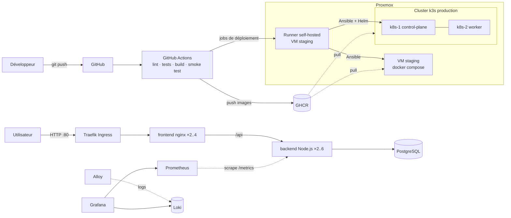
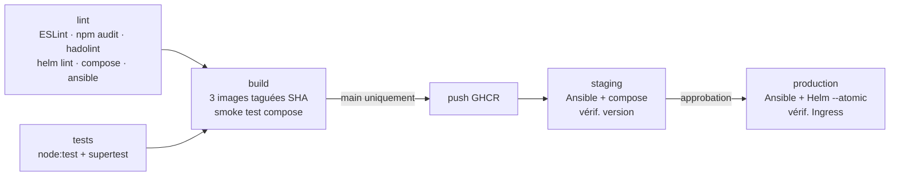

# TaskFlow : déploiement continu d'une application multi-composants

Projet DevOps / SysOps ESGI M1 (cours DevOps de Tom AVENEL). Une application web de gestion de tâches (frontend, backend, base de données) livrée en continu sur une infrastructure Proxmox, entièrement décrite en code.

Documentation :
- [Tutoriel de mise en place](docs/TUTORIEL.md)
- [Scénario de soutenance](docs/DEMO.md)
- [Contrat d'intégration inter-équipes](docs/CONTRAT-INTEGRATION.md)
- [Journal des modifications](#journal-des-modifications)

| Exigence du sujet | Mise en œuvre |
|---|---|
| Conteneurs | 1 Dockerfile par composant, images non-root, publiées sur GHCR |
| Staging | Docker Compose sur une VM dédiée |
| Production | Kubernetes k3s sur 2 VM, application packagée en chart Helm |
| IaC | Ansible : de la VM vierge au cluster supervisé + application déployée |
| CI/CD | GitHub Actions : lint, tests, build, smoke test, push, staging, production |
| Zero-downtime | Rolling update (maxUnavailable 0), probes, arrêt gracieux, PDB, rollback automatique |
| Auto-scaling | HorizontalPodAutoscaler sur le CPU (2 à 6 pods backend) |
| Observabilité | Prometheus, Grafana (dashboard des 4 golden signals), cAdvisor, Alertmanager |
| Logs centralisés | Loki + Grafana Alloy, recherche par service, date et gravité |

## Architecture



| Composant | Techno | Port | Rôle |
|---|---|---|---|
| frontend | nginx (non-root) | 8080 | Sert l'interface et fait reverse proxy de `/api` vers le backend |
| backend | Node.js 24 / Express | 3000 | API REST `/api/tasks`, migrations de schéma, métriques Prometheus |
| db | PostgreSQL 17 | 5432 | Persistance (StatefulSet + volume en production) |

## Arborescence (mono-repo)

```
app/
  backend/            API Node.js + tests + Dockerfile
  frontend/           interface statique + template nginx + Dockerfile
  db/                 image PostgreSQL (version propre dans VERSION)
deploy/
  compose/            staging : compose.yaml (+ compose.build.yaml pour le dev local, profil monitoring)
  helm/taskflow/      production : chart Helm (Deployments, HPA, PDB, StatefulSet, Ingress, ServiceMonitor, dashboard)
  k8s/                générateur de charge pour la démo d'auto-scaling
infra/ansible/        rôles common, docker, k3s_server, k3s_agent, helm, monitoring, app_staging, app_prod, github_runner
.github/workflows/    pipeline CI/CD
scripts/              vérification de disponibilité (démo zero-downtime), installation d'Ansible
docs/                 contrat d'intégration inter-équipes, scénario de démo
```

## Démarrage local (Docker Desktop)

```bash
cd deploy/compose
cp .env.example .env          # IMAGE_OWNER=local, DB_PASSWORD=...
docker compose -f compose.yaml -f compose.build.yaml up -d --build
# Application : http://localhost:8080
# + monitoring : ajouter --profile monitoring (Grafana http://localhost:3000, admin/admin)
```

Tests et lint du backend : `cd app/backend && npm ci && npm test && npm run lint`.

## Mise en place de l'infrastructure

**Le pas-à-pas complet est dans [docs/TUTORIEL.md](docs/TUTORIEL.md)** : VM Proxmox, Twingate, organisation GitHub, Ansible, runner, premier déploiement et dépannage.

| VM Proxmox | Rôle | Ressources |
|---|---|---|
| staging-1 | Docker Compose, runner GitHub Actions, poste d'administration Ansible | 2 vCPU, 4 Go |
| k8s-1 | k3s control-plane + monitoring | 4 vCPU, 6 Go |
| k8s-2 | k3s worker | 2 vCPU, 4 Go |

En résumé :
1. Renseigner les IP et l'utilisateur SSH dans [hosts.yml](infra/ansible/inventories/proxmox/hosts.yml), puis `image_owner` et `github_repository` dans [group_vars/all.yml](infra/ansible/inventories/proxmox/group_vars/all.yml).
2. Pousser sur un dépôt **public** de l'organisation GitHub. Après le premier pipeline, rendre publiques les 3 images GHCR.
3. Depuis `staging-1`, lancer `ansible-playbook playbooks/site.yml -e @secrets.yml -K`. Ce playbook idempotent construit toute l'infrastructure et déploie l'application.
4. Dans GitHub, créer les secrets, les variables et l'environnement `production` avec approbation. Installer ensuite le runner avec `playbooks/github-runner.yml`. Le runner se connecte à GitHub en sortie : aucun port n'est à ouvrir sur le réseau Proxmox.

Accès, via Twingate :

| Service | URL |
|---|---|
| Application de production | http://10.1.20.73/ |
| Grafana de production (dashboards, logs Loki) | http://10.1.20.73:30300 |
| Prometheus de production | http://10.1.20.73:30090 |
| Application de staging | http://10.1.20.72:8080 |
| Grafana de staging | http://10.1.20.72:3000 |

## Pipeline CI/CD



- **Pull request** : lint, tests, build et smoke test. Rien n'est publié ni déployé.
- **Push sur `main`** : le pipeline complet. Chaque image porte le SHA du commit : une version est identifiable de bout en bout (pipeline, registry, pied de page de l'interface, logs).
- **Exécution** : les jobs de déploiement tournent sur le runner self-hosted et appellent les **mêmes playbooks Ansible** que ceux utilisés à la main. Il n'y a pas de logique de déploiement cachée dans la CI.

## Zero-downtime et auto-scaling

| Mécanisme | Où |
|---|---|
| Rolling update `maxSurge: 1`, `maxUnavailable: 0` | [values.yaml](deploy/helm/taskflow/values.yaml) |
| Readiness `/ready` (BDD joignable, pas en arrêt) ≠ liveness `/health` | [app.js](app/backend/src/app.js), [backend.yaml](deploy/helm/taskflow/templates/backend.yaml) |
| `preStop` + arrêt gracieux sur SIGTERM (fin des requêtes en cours) | [server.js](app/backend/src/server.js) |
| Replicas répartis sur les 2 nœuds + PodDisruptionBudget : un nœud peut être drainé sans coupure | templates backend et frontend |
| `helm --atomic` : retour automatique à la version précédente si les pods ne deviennent pas prêts | [app_prod](infra/ansible/roles/app_prod/tasks/main.yml) |
| Migrations rétrocompatibles (ancienne et nouvelle version tournent ensemble pendant le rolling update) | [db.js](app/backend/src/db.js) |
| HPA CPU 60 % : backend 2→6 pods, frontend 2→4 pods ; metrics-server inclus dans k3s | templates backend et frontend |
| La BDD a son propre cycle de version : un déploiement applicatif ne redémarre pas PostgreSQL | `db.imageTag`, [app/db/VERSION](app/db/VERSION) |

Limite assumée, conformément au sujet (pas de haute disponibilité demandée) : PostgreSQL est une instance unique. Sa mise à jour provoque une courte indisponibilité.

## Observabilité

- **Métriques applicatives** (`/metrics`, prom-client) :
  - `http_requests_total` et `http_request_duration_seconds` (trafic, erreurs, latence) ;
  - `taskflow_db_up` ;
  - `taskflow_tasks_created_total` (métrique métier) ;
  - métriques process et event loop Node.js (saturation).
- **Métriques d'infrastructure** : cAdvisor via le kubelet (CPU et mémoire par conteneur), node-exporter, kube-state-metrics (replicas, redémarrages).
- **Dashboard** *TaskFlow - Golden signals*, livré avec la chart et chargé automatiquement par Grafana ; c'est le même fichier en staging.
- **Logs** : JSON sur stdout (backend pino, frontend nginx) avec un champ `level`. Exemple de requête dans Grafana > Explore > Loki : `{namespace="taskflow", component="backend", level="error"}`.
- **Alertes** : règles par défaut de kube-prometheus-stack (pod en crash loop, nœud indisponible…).

## Ce qui a été validé

Tests réalisés le 23/11/2026 sur un k3s v1.31 dans Docker :

| Test | Résultat |
|---|---|
| Tests unitaires et d'API | 16/16 réussis, ESLint propre |
| Hadolint (3 Dockerfiles), `helm lint`, `ansible-playbook --syntax-check`, config Alloy | OK |
| Stack docker compose : création, mise à jour et lecture de tâches via le frontend, métriques, logs JSON | OK |
| Grafana (compose) : dashboard provisionné (13 panneaux), cibles Prometheus `up` | OK |
| Arrêt gracieux du backend (SIGTERM) | sortie propre (code 0) après 5 s |
| Recréation du backend seul en compose (nouvelle IP) | 40/40 requêtes OK |
| Rolling update v1 → v2 sous trafic continu | 898 requêtes, **0 erreur**, données conservées |
| Rolling update v3 → v4 (frontend + backend) sous trafic | 523 requêtes, **0 erreur** |
| Auto-scaling sous charge | 2 → 6 pods backend en ~45 s, retour à 2 après la charge |
| Déploiement d'une image inexistante | rollback automatique, 473 requêtes, **0 erreur** |
| Ansible sur un Debian 13.7 nu (root, sans Python ni sudo) : `bootstrap.yml`, rôles `common` et `docker` (dépôt Docker trixie) | OK jusqu'aux étapes qui demandent systemd, absent d'un conteneur |
| Compte sudoer `admin` sur Debian 13 : 1er passage avec mot de passe sudo (`-K`), puis 2e passage sans mot de passe, comme la CI | OK : règle `NOPASSWD` posée, élévation sans mot de passe ensuite |

Pas encore exécuté sur les VM Proxmox : les playbooks complets (socle, k3s multi-nœuds, kube-prometheus-stack, Loki/Alloy), le runner GitHub et le pipeline sur GitHub.

## Difficultés rencontrées et solutions

| Problème constaté en test | Cause | Solution |
|---|---|---|
| Les pods backend restent en `CreateContainerConfigError` | `USER node` (nom) dans le Dockerfile : Kubernetes ne peut pas vérifier `runAsNonRoot` | UID numérique `USER 1000:1000`, règle B5 du contrat d'intégration |
| Erreurs 502 après la recréation du backend en docker compose | nginx résout le nom du backend une seule fois, au démarrage, et garde l'ancienne IP | `resolver` dynamique (DNS détecté par l'image nginx) et variable dans `proxy_pass` ; FQDN du Service en Kubernetes |
| Une mise à jour casse `/api` alors que Helm la déclare réussie | Le frontend est « prêt » (sa sonde ne teste pas le backend), donc `--atomic` ne voit rien | Smoke test post-déploiement frontend → backend → BDD dans Ansible, avec `helm rollback` automatique en cas d'échec |
| Arrêt gracieux interrompu (SIGKILL au bout de 3 s) en compose | Délai d'arrêt Docker trop court | `stop_grace_period: 20s` explicite |
| Pas de métriques par conteneur avec cAdvisor sous Docker Desktop | cAdvisor ne voit pas les conteneurs de Docker Desktop | En production, on utilise le cAdvisor intégré au kubelet (k3s) ; sur la VM staging, le daemon Docker accepte les anciens clients API |

## Documentation

- [docs/TUTORIEL.md](docs/TUTORIEL.md) : la mise en place pas à pas, des VM vierges au premier déploiement continu.
- [docs/CONTRAT-INTEGRATION.md](docs/CONTRAT-INTEGRATION.md) : la spécification commune proposée aux autres équipes, côté conteneurs (DevOps) et côté plateforme (SysOps).
- [docs/DEMO.md](docs/DEMO.md) : le déroulé de la soutenance, critère par critère.

## Répartition des rôles

| Membre | Rôle | Périmètre principal |
|---|---|---|
| _à compléter_ | Dev / App | `app/`, tests, contrat d'intégration |
| _à compléter_ | Infra / SysOps | `infra/ansible/`, k3s, chart Helm, zero-downtime, HPA |
| _à compléter_ | CI/CD | `.github/workflows/`, registry, runner, environnements GitHub |
| _à compléter_ | Observabilité | monitoring, dashboard, Loki, alertes, dossier de projet |

## Journal des modifications

Le plus récent en haut. Chaque modification du projet est notée ici.

### 23/11/2026 : publication du dépôt
- Premier push sur https://github.com/ESGI-M1-DEVOPS/taskflow (branche `main`), qui déclenche le premier pipeline CI/CD.
- Le commit initial créé par GitHub (README « demo app cours devops Tom AVENEL ») est conservé dans l'historique ; sa mention du cours est reprise en tête de ce README.

### 23/11/2026 : connexion avec le compte sudoer `admin`
- Ansible se connecte avec le compte `admin` (sudoer) au lieu de `root`. Premier `site.yml` avec `-K` ; le rôle `common` configure ensuite sudo sans mot de passe pour `admin`, ce dont la CI a besoin.
- Tutoriel adapté : commandes avec `sudo`, `ssh-copy-id admin@...`, `~/.ssh/config` avec `User admin`, consigne de changer le mot de passe par défaut une fois les clés en place. Le mot de passe n'apparaît nulle part dans le dépôt.
- Parcours testé sur Debian 13 : 1er passage avec mot de passe sudo, 2e passage sans.

### 23/11/2026 : configuration de l'environnement réel
- Inventaire renseigné : organisation `ESGI-M1-DEVOPS` (images `ghcr.io/esgi-m1-devops/...`), VM 10.1.20.72 à 10.1.20.74 sous Debian 13, connexion en `root`.
- Nouveau playbook [bootstrap.yml](infra/ansible/playbooks/bootstrap.yml) : installe python3 et sudo s'ils manquent (cas d'un Debian installé avec un mot de passe root). Il est importé par `site.yml` et `github-runner.yml`.
- Rôles adaptés à `root` : règle sudoers et groupe docker ignorés ; `bootstrap-controller.sh` n'utilise plus sudo en root.
- Les rôles lisent les facts via `ansible_facts[...]` (`inject_facts_as_vars = False`) : plus aucun avertissement avec ansible-core 2.21, compatible avec la 2.24.
- Tutoriel, scénario de démo, contrat d'intégration et README mis à jour avec les vraies valeurs (IP, organisation).
- Testé sur un Debian 13.7 nu dans Docker.

### 23/11/2026 : préparation du déploiement sur Proxmox
- Ajout du [tutoriel de mise en place](docs/TUTORIEL.md), adapté au contexte : VM Proxmox, accès Twingate, organisation GitHub, Ansible lancé depuis la VM staging.
- Ansible configure sudo sans mot de passe pour l'utilisateur de déploiement : la CI ne peut pas saisir de mot de passe. Premier lancement manuel avec `-K`.
- Runner GitHub : installation explicite des dépendances système (ICU, Kerberos, zlib) pour les versions récentes de Debian et Ubuntu.
- README : la section de mise en place renvoie vers le tutoriel ; ajout de ce journal.

### 23/11/2026 : correctifs issus des tests
- Backend exécuté avec un UID numérique (`USER 1000:1000`) : Kubernetes peut vérifier `runAsNonRoot`.
- Frontend : résolution DNS dynamique du backend (`resolver` nginx et variable dans `proxy_pass`) ; FQDN du Service en Kubernetes.
- Déploiement en production : smoke test frontend → backend → BDD après Helm, avec `helm rollback` automatique en cas d'échec.
- docker compose : `stop_grace_period` explicite pour l'arrêt gracieux du backend.
- Vérification périodique de la BDD : la métrique `taskflow_db_up` reste à jour même sans sonde.

### 23/11/2026 : version initiale
- Application TaskFlow : backend Node.js/Express avec 16 tests, frontend nginx, PostgreSQL ; 1 Dockerfile par composant.
- Staging docker compose avec profil monitoring (Prometheus, Grafana, cAdvisor).
- Production : chart Helm (rolling update, HPA, PDB, StatefulSet, Ingress, ServiceMonitor, dashboard Grafana).
- Ansible : socle, Docker, k3s 2 nœuds, Helm, kube-prometheus-stack, Loki/Alloy, déploiements staging et production, runner GitHub.
- Pipeline GitHub Actions : lint, tests, build, smoke test, push GHCR, staging, production avec approbation.
- Documentation : contrat d'intégration inter-équipes, scénario de démo.
