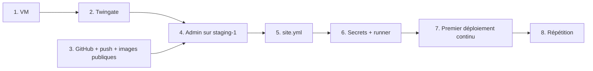

# Tutoriel : des VM vierges à la soutenance

Ce guide monte toute la plateforme TaskFlow pas à pas : VM Proxmox, accès Twingate, dépôt GitHub, infrastructure Ansible, pipeline CI/CD. Chaque étape se termine par une **vérification** : ne passez à la suite que si elle est bonne.

Durée totale : environ 2 h, attentes d'installation comprises.

## Notre environnement

| Élément | Valeur |
|---|---|
| Organisation GitHub | `ESGI-M1-DEVOPS` (dans les noms d'images : `esgi-m1-devops`) |
| Dépôt | `https://github.com/ESGI-M1-DEVOPS/taskflow` |
| Images | `ghcr.io/esgi-m1-devops/taskflow-{frontend,backend,db}` |
| VM staging (+ poste d'admin Ansible + runner CI) | `staging-1`, **10.1.20.72** |
| VM k3s control-plane | `k8s-1`, **10.1.20.73** |
| VM k3s worker | `k8s-2`, **10.1.20.74** |
| OS, compte SSH | Debian 13, compte sudoer `admin` (le même sur les 3 VM) |
| Accès distant | Twingate |

Ces valeurs sont **déjà renseignées** dans [hosts.yml](../infra/ansible/inventories/proxmox/hosts.yml) et [group_vars/all.yml](../infra/ansible/inventories/proxmox/group_vars/all.yml).

> 🔒 Le dépôt est public : **n'écrivez jamais le mot de passe du compte `admin`** dans un fichier du projet, une issue ou un commit.

Les blocs de commandes indiquent où les lancer : **Windows (PowerShell)** ou **staging-1 (bash)**.

## Qui fait quoi (en parallèle)

| Personne | Étapes |
|---|---|
| A | 1. VM Proxmox, puis 2. Twingate |
| B | 3. Dépôt GitHub, premier pipeline, images publiques |
| C | 4 et 5 dès que les VM et le dépôt sont prêts : poste d'admin et Ansible |
| D | 6. CI/CD (secrets, environnement, runner), puis répétition de la démo ([DEMO.md](DEMO.md)) |



---

## Étape 1 : les VM Proxmox (≈ 20 min)

| VM | Hostname | IP | vCPU | RAM | Disque |
|---|---|---|---|---|---|
| staging | `staging-1` | 10.1.20.72 | 2 | 4 Go | 30 Go |
| k3s control-plane | `k8s-1` | 10.1.20.73 | 4 | 6 Go | 40 Go |
| k3s worker | `k8s-2` | 10.1.20.74 | 2 | 4 Go | 30 Go |

- Debian 13 avec le **serveur SSH** et le compte sudoer **`admin`**. Si Python manque, Ansible l'installe lui-même.
- **IP fixes** : elles sont écrites dans l'inventaire Ansible.
- **Accès Internet** depuis les VM : apt, get.k3s.io, github.com et ghcr.io doivent être joignables.

> ⚠️ **VM clonées depuis un template** : chaque VM doit avoir un hostname **et** un machine-id uniques. Sinon, k3s refuse le deuxième nœud. Sur chaque clone :
> ```bash
> sudo hostnamectl set-hostname k8s-2          # le nom de CETTE VM
> sudo rm -f /etc/machine-id /var/lib/dbus/machine-id
> sudo systemd-machine-id-setup
> sudo reboot
> ```

✅ **Vérification**, sur `staging-1` (console Proxmox ou SSH) :

```bash
hostname                                    # staging-1
ping -c1 10.1.20.73 && ping -c1 10.1.20.74  # les autres VM répondent
cat /etc/machine-id                         # valeur différente sur chaque VM
sudo apt-get update >/dev/null && echo "sudo et Internet OK"
```

---

## Étape 2 : accès Twingate (≈ 10 min)

Dans la console d'administration Twingate, sur le réseau remote qui contient le connecteur Proxmox :

1. **Ajouter les ressources** `10.1.20.72`, `10.1.20.73` et `10.1.20.74` (ou le sous-réseau qui les contient), avec ces ports TCP :

   | Port | Usage |
   |---|---|
   | 22 | SSH |
   | 80 | application de production (Ingress) |
   | 8080 | application de staging |
   | 3000, 9090 | Grafana et Prometheus du staging |
   | 30300, 30090 | Grafana et Prometheus de production |
   | 6443 | API Kubernetes (`kubectl` depuis un PC) |

   Le plus simple est d'autoriser tous les ports.
2. **Donner l'accès** à un groupe qui contient les 4 membres de l'équipe.

✅ **Vérification**, Twingate connecté :

```powershell
# Windows (PowerShell)
ssh admin@10.1.20.72 hostname               # affiche staging-1
Test-NetConnection 10.1.20.73 -Port 22      # TcpTestSucceeded : True
```

---

## Étape 3 : dépôt GitHub et premier pipeline (≈ 15 min)

### 3.1 Réglages de l'organisation (une fois, par un owner)

Dans `https://github.com/organizations/ESGI-M1-DEVOPS/settings` :

- **People** : les 4 membres font partie de l'organisation.
- **Actions > General** :
  - *Actions permissions* : « Allow all actions and reusable workflows » ;
  - *Fork pull request workflows from outside collaborators* : « Require approval for all outside collaborators ». C'est important : le runner self-hosted tourne chez vous.
- **Packages > Package creation** : cocher **Public**.

### 3.2 Créer le dépôt

*New repository* dans `ESGI-M1-DEVOPS` : nom **`taskflow`**, visibilité **Public**, **sans** README, .gitignore ni licence.

> Pourquoi public : sur le plan gratuit de GitHub, les *environnements avec approbation* (mise en production semi-automatique) n'existent que pour les dépôts publics.

### 3.3 Pousser le code

La configuration (IP, organisation, compte `admin`) est déjà renseignée.

```powershell
# Windows (PowerShell)
cd "C:\Users\t.chalaron\Desktop\DOSSIER ECOLE ESGI\M1\DevOps\taskflow"
git init -b main
git add .
git update-index --chmod=+x scripts/bootstrap-controller.sh scripts/check-availability.sh
git commit -m "TaskFlow : application, IaC, CI/CD et observabilité"
git remote add origin https://github.com/ESGI-M1-DEVOPS/taskflow.git
git push -u origin main
```

### 3.4 Premier pipeline

Ouvrir `https://github.com/ESGI-M1-DEVOPS/taskflow/actions`. Les jobs `Lint & analyse statique`, `Tests automatisés` puis `Build, smoke test & publication des images` doivent passer au vert, en 5 min environ.

Le job `Déploiement staging` reste en *Waiting for a runner* : c'est normal, le runner arrive à l'étape 6. On peut annuler le run (*Cancel workflow*) une fois `build` terminé.

### 3.5 Rendre les images publiques

Ouvrir `https://github.com/orgs/ESGI-M1-DEVOPS/packages`. Pour `taskflow-backend`, `taskflow-frontend` et `taskflow-db` : *Package settings > Danger Zone > Change visibility > Public*.

✅ **Vérification**, sans être connecté à ghcr.io :

```powershell
# Windows (PowerShell)
docker pull ghcr.io/esgi-m1-devops/taskflow-backend:latest
```

---

## Étape 4 : staging-1 devient le poste d'administration (≈ 15 min)

Ansible ne tourne pas sous Windows. On le lance depuis `staging-1` : elle est déjà dans le réseau Proxmox et hébergera aussi le runner de la CI.

```bash
# staging-1 (bash) : ssh admin@10.1.20.72
sudo apt-get update && sudo apt-get install -y git
git clone https://github.com/ESGI-M1-DEVOPS/taskflow.git
cd taskflow
bash scripts/bootstrap-controller.sh
echo 'export PATH="$HOME/.venvs/ansible/bin:$PATH"' >> ~/.bashrc
echo 'export ANSIBLE_PRIVATE_KEY_FILE="$HOME/.ssh/ansible"' >> ~/.bashrc
source ~/.bashrc
```

**Clé SSH dédiée à Ansible.** C'est la même qui sera donnée à la CI. `ssh-copy-id` demande une dernière fois le mot de passe du compte `admin` de chaque VM :

```bash
ssh-keygen -t ed25519 -f ~/.ssh/ansible -N "" -C "ansible-taskflow"
for ip in 10.1.20.72 10.1.20.73 10.1.20.74; do ssh-copy-id -i ~/.ssh/ansible.pub admin@$ip; done
# utiliser cette clé par défaut pour les ssh lancés depuis staging-1
printf 'Host 10.1.20.72 10.1.20.73 10.1.20.74\n  User admin\n  IdentityFile ~/.ssh/ansible\n' >> ~/.ssh/config
chmod 600 ~/.ssh/config
```

**Secrets** :

```bash
cd ~/taskflow/infra/ansible
cp secrets.example.yml secrets.yml
openssl rand -hex 32        # à copier dans k3s_token
nano secrets.yml            # db_password, k3s_token, grafana_admin_password
```

> Notez `db_password` et `grafana_admin_password` : les **mêmes valeurs** iront dans les secrets GitHub à l'étape 6. `secrets.yml` est ignoré par git : il ne sera jamais poussé.

✅ **Vérification** :

```bash
ansible all -m raw -a "hostname"
# staging-1 | CHANGED | rc=0 >> staging-1
# k8s-1 | CHANGED | rc=0 >> k8s-1
# k8s-2 | CHANGED | rc=0 >> k8s-2
```

---

## Étape 5 : construire toute l'infrastructure (≈ 20 à 30 min)

```bash
# staging-1 (bash), dans ~/taskflow/infra/ansible
ansible-playbook playbooks/site.yml -e @secrets.yml -K
```

`-K` affiche `BECOME password:` : tapez le mot de passe du compte `admin`. Ce n'est utile qu'au **premier lancement** : le playbook configure ensuite sudo sans mot de passe pour `admin`, ce dont la CI a besoin. Les fois suivantes, `-K` est inutile.

Le playbook enchaîne :
1. les prérequis (python3, sudo) ;
2. le socle commun ;
3. Docker sur staging ;
4. k3s sur les 2 nœuds et Helm ;
5. Prometheus, Grafana, Loki et Alloy ;
6. TaskFlow en staging puis en production.

Le récapitulatif final doit afficher **`failed=0`** pour les 3 VM.

> Si l'installation du monitoring dépasse le délai (téléchargement lent), relancez **la même commande** : le playbook est idempotent et reprend là où il en était.

✅ **Vérifications** :

```bash
ssh 10.1.20.73 kubectl get nodes              # k8s-1 et k8s-2 : Ready
ssh 10.1.20.73 kubectl get pods -A            # tout est Running ou Completed
ssh 10.1.20.73 kubectl -n taskflow get hpa    # 2 HPA, cibles CPU connues (pas <unknown>)
```

Puis, dans le navigateur sous Windows (Twingate connecté) :

| URL | Attendu |
|---|---|
| http://10.1.20.73/ | TaskFlow en production ; créer une tâche |
| http://10.1.20.72:8080/ | TaskFlow en staging |
| http://10.1.20.73:30300/ | Grafana, identifiant `admin` / `grafana_admin_password` ; *Dashboards > TaskFlow - Golden signals* |
| Grafana > *Explore* > **Loki** | requête `{namespace="taskflow"}` : les logs arrivent |
| http://10.1.20.73:30090/ | Prometheus, *Status > Targets* : la cible `taskflow-backend` est UP |

**Facultatif : `kubectl` depuis Windows.** Le playbook a récupéré le kubeconfig sur staging-1 :

```powershell
# Windows (PowerShell)
scp admin@10.1.20.72:taskflow/infra/ansible/kubeconfig-prod.yaml $HOME\kubeconfig-prod.yaml
$env:KUBECONFIG = "$HOME\kubeconfig-prod.yaml"
kubectl get nodes
```

---

## Étape 6 : brancher la CI/CD sur le Proxmox (≈ 15 min)

Tout se passe dans `https://github.com/ESGI-M1-DEVOPS/taskflow/settings`.

### 6.1 Secrets

*Secrets and variables > Actions > Secrets > New repository secret* :

| Nom | Valeur |
|---|---|
| `ANSIBLE_SSH_PRIVATE_KEY` | sortie de `cat ~/.ssh/ansible` sur staging-1, **lignes BEGIN et END comprises** |
| `DB_PASSWORD` | **la même** valeur que `db_password` dans `secrets.yml` |
| `GRAFANA_ADMIN_PASSWORD` | **la même** valeur que `grafana_admin_password` |

> ⚠️ Si `DB_PASSWORD` diffère de `secrets.yml`, le backend ne pourra plus se connecter : PostgreSQL garde le mot de passe de sa création.

### 6.2 Variables

Onglet *Variables* :
- `STAGING_URL` = `http://10.1.20.72:8080`
- `PROD_URL` = `http://10.1.20.73`

### 6.3 Environnement de production

*Environments > production* (il existe déjà depuis le premier pipeline ; sinon *New environment*) : cocher **Required reviewers** et ajouter 1 ou 2 membres de l'équipe.

### 6.4 Runner self-hosted

1. *Actions > Runners > New self-hosted runner > Linux*. Copier **uniquement le jeton** de la ligne `./config.sh --url ... --token XXXXXXXX`. Il est valable 1 h.
2. Installer le runner :
   ```bash
   # staging-1 (bash), dans ~/taskflow/infra/ansible
   ansible-playbook playbooks/github-runner.yml -e @secrets.yml -e github_runner_token=XXXXXXXX
   ```

✅ **Vérification** : dans *Actions > Runners*, `staging-1` apparaît **Idle** avec les labels `self-hosted`, `Linux`, `X64`, `proxmox`.

---

## Étape 7 : premier déploiement continu (≈ 10 min)

1. Faire un changement visible depuis Windows, par exemple le sous-titre dans [app/frontend/public/index.html](../app/frontend/public/index.html) :
   ```powershell
   git add . ; git commit -m "Nouveau sous-titre" ; git push
   ```
2. Dans **Actions**, suivre le run : lint et tests, puis build, puis **staging** (automatique), puis **production**, qui attend l'approbation (*Review deployments > Approve*).
3. Pendant le déploiement en production, lancer la sonde de disponibilité :
   ```powershell
   .\scripts\check-availability.ps1 -Url http://10.1.20.73
   ```

✅ **Vérification** :
- le pied de page de http://10.1.20.73/ affiche le **SHA du commit** ;
- la sonde affiche **0 erreur** pendant la bascule.

> Après un push, pensez à `git pull` dans `~/taskflow` sur staging-1 avant de relancer un playbook à la main. La CI, elle, récupère toujours le code à jour toute seule.

---

## Étape 8 : préparer la soutenance

- [ ] **Changer le mot de passe du compte `admin`** sur les 3 VM (`passwd`) : c'est un mot de passe par défaut. Ansible et la CI n'en ont plus besoin, ils passent par la clé SSH et sudo sans mot de passe.
- [ ] Répéter le déroulé de [DEMO.md](DEMO.md) au moins une fois, chronomètre en main.
- [ ] **Enregistrer une vidéo de secours** de la démo complète (Win+G ou OBS) au cas où le réseau ou Twingate ferait défaut le jour J.
- [ ] Préparer la branche de fonctionnalité à merger en direct (étape 4 de DEMO.md).
- [ ] Remplir la répartition des rôles dans le [README](../README.md).
- [ ] Le matin même : Twingate connecté, VM allumées, pipeline vert, Grafana ouvert sur le dashboard.

---

## Dépannage

| Symptôme | Cause probable | Solution |
|---|---|---|
| `ansible all ...` : `Permission denied (publickey)` | clé non copiée sur une VM | refaire `ssh-copy-id -i ~/.ssh/ansible.pub admin@<IP>` |
| `Missing sudo password` | premier lancement sans `-K` | relancer avec `-K` |
| Job CI en échec : `sudo: a password is required` | `site.yml` n'a jamais été mené jusqu'au rôle `common` | relancer `site.yml -e @secrets.yml -K` depuis staging-1 |
| Le worker k8s-2 n'apparaît pas dans `kubectl get nodes` | VM clonée : hostname ou machine-id identiques | encadré de l'étape 1, puis `sudo /usr/local/bin/k3s-agent-uninstall.sh` sur k8s-2 et relancer `site.yml` |
| Pods en `ImagePullBackOff` | images GHCR encore privées | étape 3.5 |
| Pods en `Pending` | RAM ou CPU insuffisants | `kubectl describe pod <pod>` ; augmenter la RAM de la VM, ou `loki_enabled: false` dans `group_vars/all.yml` |
| Timeout sur `kube-prometheus-stack` | téléchargement des images trop lent | relancer `site.yml` (idempotent) |
| HPA en `<unknown>` | metrics-server pas encore prêt | attendre 1 à 2 min |
| Job CI bloqué en *Waiting for a runner* | runner arrêté ou mauvais label | `systemctl status 'actions.runner.*'` sur staging-1 ; label `proxmox` présent ? |
| Pas de bouton d'approbation de la production | dépôt privé sur le plan gratuit | passer le dépôt en public (étape 3.2) |
| Backend en erreur d'authentification PostgreSQL | `DB_PASSWORD` différent entre GitHub et `secrets.yml` | remettre la valeur d'origine dans le secret GitHub |
| Dans les logs du playbook : `rollback effectué` | le smoke test post-déploiement a échoué : l'ancienne version est toujours servie | voir les logs : `kubectl -n taskflow logs deploy/taskflow-backend` |
